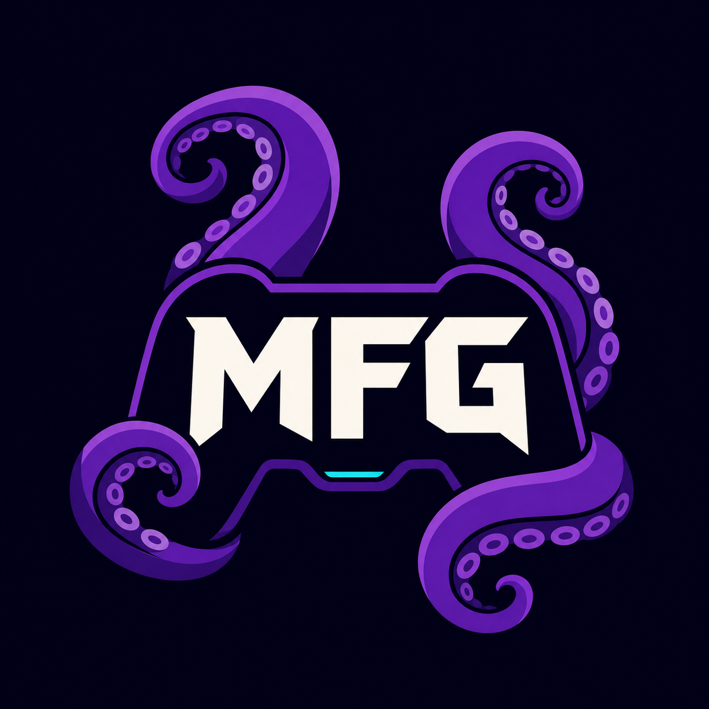

# Moonlight Forwarder Generator

[Português](README.md) | **English**

<p align="center">
  
</p>

<p align="center">
  
  
  <a href="https://github.com/Thayrone-L/MoonlightForwarderGen/actions/workflows/ci.yml"></a>
</p>

Launch your PC games directly from the Nintendo Switch HOME menu.

**Moonlight Forwarder Generator (MFG)** prepares your computer, creates a shortcut with a title and cover for each game, and delivers everything to the SD card. On the Switch, **MFG Updater** adds the shortcut to the HOME menu. Opening it starts the game stream through Moonlight.

> **Alpha `0.1.0-alpha.1`:** this is an early test release. Back up your SD card before you begin.

## Our goal

MFG was created to democratize and simplify Sunshine and Moonlight. Its purpose is to turn a setup that usually requires technical knowledge, manual file editing, and several tools into a guided, visual experience accessible to people with little or no game-streaming knowledge.

The app safely automates everything it can on the computer and explains the steps that still require user confirmation. Nintendo Switch integration requires a console that is already able to run homebrew.

## How it works

```text
HOME Menu shortcut → Moonlight-Switch → Sunshine → game on the PC
```

MFG:

- finds Steam and Epic games and lets you add other executables;
- installs or prepares Sunshine with your confirmation;
- generates a shortcut using the game's title and cover;
- automatically copies the library and MFG Updater to the SD card;
- verifies file integrity before installation on the Switch.

## Before you begin

This guide does not require programming knowledge, but it assumes your Switch is already set up to run homebrew. MFG does not modify a stock console or provide console-modding instructions.

Check the following items:

- [ ] a 64-bit Windows 10 or 11 computer;
- [ ] a Nintendo Switch able to open the Homebrew Menu;
- [ ] [Moonlight-Switch](https://github.com/XITRIX/Moonlight-Switch) installed at `SD:/switch/Moonlight-Switch/`;
- [ ] a `prod.keys` file legally extracted from your own console;
- [ ] computer and Switch connected to the same network;
- [ ] a recent backup of the SD card.

You do not need to install .NET, Node.js, or Sunshine beforehand. The MFG package includes the required components, and the setup wizard can prepare Sunshine.

> Parts of the current alpha interface are still in Brazilian Portuguese. This guide shows each relevant Portuguese label followed by its English meaning while localization continues.

## 1. Install MFG on the computer

1. Open the [Releases](https://github.com/Thayrone-L/MoonlightForwarderGen/releases) page.
2. Download `MoonlightForwarderGenerator-*-win-x64.zip` from the latest release.
3. Right-click the ZIP, choose **Extract All**, and open the extracted folder.
4. Run `MFG.App.exe`.
5. If Windows SmartScreen appears, confirm that the file came from this repository, click **More info**, then **Run anyway**.
6. On the first screen, choose **Português** or **English**, then click **Continue / Continuar**.

Do not run the application from inside the ZIP. Extract every file first.

Your language choice is saved for the current Windows user. In this alpha, the language selector and initial setup are available in both languages; the rest of the interface is being localized progressively.

## 2. Complete initial setup

On first launch, follow the wizard's four stages:

### Prepare the computer

Click **Preparar computador (Prepare computer)**. If Sunshine is missing, MFG downloads its official installer and Windows asks for confirmation. Complete the installer and wait for **Computador pronto (Computer ready)**.

### Select the key file

Click **Selecionar arquivo de chave (Select key file)** and choose the `prod.keys` from your own Switch. The key is protected for the current Windows user and is never copied to the SD card.

### Pair the Switch

1. Put the SD card back into the Switch.
2. Open Moonlight-Switch.
3. Add the computer where MFG is running.
4. On the computer, open `https://localhost:47990`. On the first visit, Sunshine may ask you to create a username and password, and the browser may warn about its local certificate.
5. When a PIN appears on the Switch, enter it on Sunshine's **PIN** page.
6. Close Moonlight-Switch and reconnect the SD card to the computer.
7. In MFG, click **Verificar cartão SD (Check SD card)**.

The card is ready when it contains `SD:/switch/Moonlight-Switch/settings.json`. If you need to stop, click **Configurar depois (Set up later)**; the wizard resumes the saved stage next time.

## 3. Add your first game

1. Select a game in the library found by MFG.
2. If it is missing, open **Não encontrou seu jogo? (Can't find your game?)**, enter a title, and select its `.exe` file.
3. Review the title and cover.
4. Click **Adicionar ao Switch (Add to Switch)**.
5. Wait for confirmation that the shortcut was created.
6. Connect the SD card and click **Atualizar (Update)** to ensure the library is copied.

MFG writes shortcuts to `SD:/switch/MFG/` and automatically installs or updates the companion at `SD:/switch/MFG-Updater/`.

## 4. Add the shortcut to the HOME menu

1. Safely eject the SD card and insert it into the Switch.
2. Open the Homebrew Menu.
3. Run **MFG Updater**.
4. Select the desired game.
5. Confirm **Adicionar ao menu HOME (Add to HOME menu)**.
6. Return to the HOME menu and open the new shortcut.

MFG Updater accepts only shortcuts produced by MFG and blocks missing or corrupted files.

## Update MFG

1. Download the new ZIP from [Releases](https://github.com/Thayrone-L/MoonlightForwarderGen/releases).
2. Close MFG.
3. Extract the new version into a clean folder.
4. Run the new `MFG.App.exe`.

Your library, protected key, and settings are kept in your Windows profile and are not deleted when you replace the application folder.

## Common problems

- **The SD card was not found:** make sure it appears in File Explorer and contains `switch/Moonlight-Switch`.
- **Continuar (Continue) is disabled:** complete the current stage; the text above the button describes what is missing.
- **The game is not listed:** use **Não encontrou seu jogo? (Can't find your game?)** and select its executable manually.
- **MFG Updater reports invalid integrity:** reconnect the card to the computer and click **Atualizar (Update)** again.
- **The shortcut opens, but the game does not start:** make sure Sunshine is running and Moonlight-Switch can still open the computer normally.

See the full [troubleshooting guide](docs/Troubleshooting.en.md) for diagnostics and log locations.

## For developers and recruiters

- [Architecture overview](docs/Architecture.en.md)
- [Technical decisions](docs/Decisions.en.md)
- [Roadmap](docs/Roadmap.en.md)
- [Build, test, and release](docs/Development.en.md)
- [Computer-to-Switch contract](docs/Protocol.en.md)
- [How to contribute](CONTRIBUTING.en.md)

## Security and responsibility

- Use only keys extracted from your own console and games you own.
- MFG Updater is not a general-purpose NSP installer.
- This project is not affiliated with Nintendo, Moonlight, Sunshine, Steam, or Epic Games.

Found a bug or have a suggestion? Open an [issue](https://github.com/Thayrone-L/MoonlightForwarderGen/issues) describing the problem and the steps required to reproduce it.
