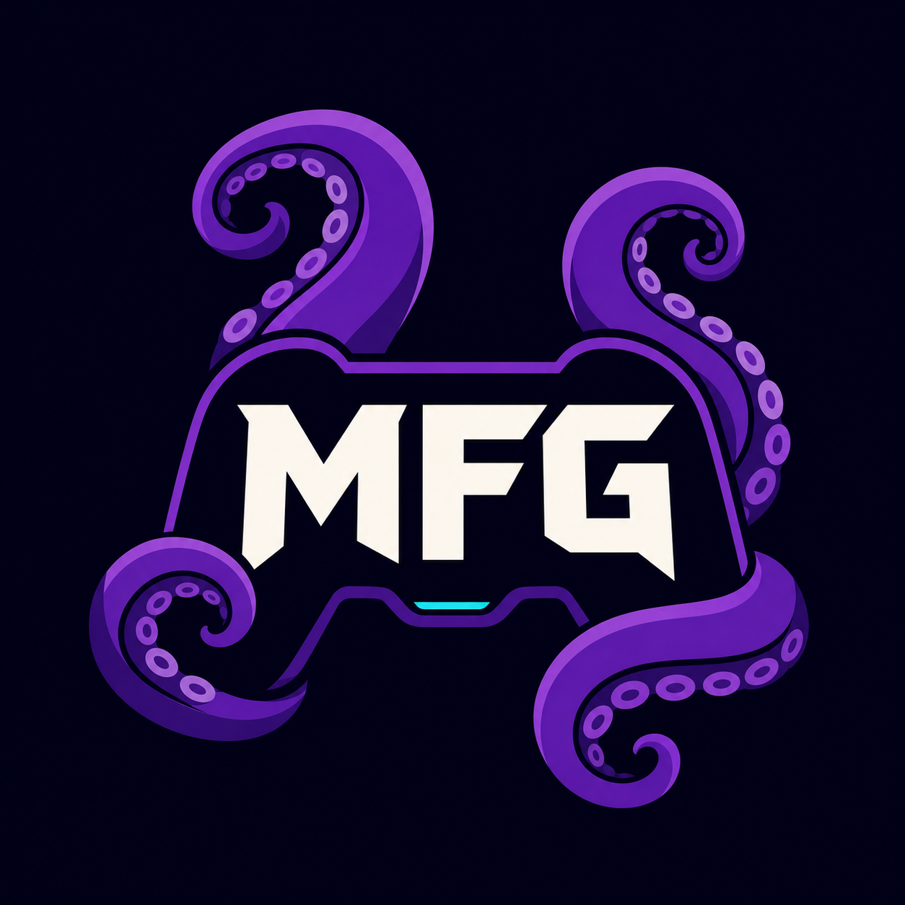

# Moonlight Forwarder Generator

**Português** | [English](README.en.md)

<p align="center">
  
</p>

<p align="center">
  
  
  <a href="https://github.com/Thayrone-L/MoonlightForwarderGen/actions/workflows/ci.yml"></a>
</p>

Abra seus jogos de PC diretamente pelo menu HOME do Nintendo Switch.

O **Moonlight Forwarder Generator (MFG)** prepara o computador, cria um atalho com nome e capa para cada jogo e entrega tudo ao cartão SD. No Switch, o **MFG Updater** adiciona o atalho ao menu HOME. Ao abri-lo, o jogo é transmitido pelo Moonlight.

> **Alpha `0.1.0-alpha.1`:** versão inicial para testes. Faça backup do cartão SD antes de começar.

## Nosso objetivo

O MFG nasceu para democratizar e facilitar o uso do Sunshine e do Moonlight. A proposta é transformar uma configuração que normalmente exige conhecimento técnico, edição de arquivos e várias ferramentas em uma experiência guiada, visual e acessível para pessoas com pouco ou nenhum conhecimento sobre streaming de jogos.

O aplicativo automatiza tudo o que pode ser feito com segurança no computador e explica as etapas que ainda precisam de confirmação do usuário. Para utilizar a integração com o Nintendo Switch, o console já deve estar preparado para executar homebrew.

## Como funciona

```text
Atalho no menu HOME → Moonlight-Switch → Sunshine → jogo no computador
```

O MFG:

- encontra jogos da Steam e Epic e permite adicionar outros executáveis;
- instala ou prepara o Sunshine com sua confirmação;
- gera o atalho usando nome e capa;
- copia automaticamente a biblioteca e o MFG Updater para o cartão SD;
- verifica a integridade dos arquivos antes da instalação no Switch.

## Antes de começar

Este guia não exige conhecimento de programação, mas pressupõe que seu Switch já esteja preparado para executar homebrew. O MFG não modifica um console original nem ensina a desbloqueá-lo.

Confirme os itens abaixo:

- [ ] computador com Windows 10 ou 11 de 64 bits;
- [ ] Nintendo Switch capaz de abrir o Homebrew Menu;
- [ ] [Moonlight-Switch](https://github.com/XITRIX/Moonlight-Switch) instalado em `SD:/switch/Moonlight-Switch/`;
- [ ] arquivo `prod.keys` extraído legalmente do seu próprio console;
- [ ] computador e Switch conectados à mesma rede;
- [ ] backup recente do cartão SD.

Você não precisa instalar .NET, Node.js ou Sunshine antecipadamente. O pacote do MFG inclui os componentes necessários e o assistente pode preparar o Sunshine.

## 1. Instalar o MFG no computador

1. Abra a página de [Releases](https://github.com/Thayrone-L/MoonlightForwarderGen/releases).
2. Na versão mais recente, baixe `MoonlightForwarderGenerator-*-win-x64.zip`.
3. Clique com o botão direito no ZIP, escolha **Extrair Tudo** e abra a pasta extraída.
4. Execute `MFG.App.exe`.
5. Se o Windows SmartScreen aparecer, confirme que o arquivo veio deste repositório, clique em **Mais informações** e depois em **Executar assim mesmo**.
6. Na primeira tela, escolha **Português** ou **English** e clique em **Continue / Continuar**.

Não execute o aplicativo dentro do ZIP. Extraia todos os arquivos antes de abrir.

A escolha do idioma fica salva neste usuário do Windows. Nesta alpha, o seletor e a configuração inicial já estão disponíveis nos dois idiomas; a tradução do restante da interface está sendo feita progressivamente.

## 2. Fazer a configuração inicial

Na primeira abertura, siga as quatro etapas do assistente:

### Preparar computador

Clique em **Preparar computador**. Se o Sunshine não estiver instalado, o MFG baixa o instalador oficial e o Windows pedirá sua confirmação. Conclua o instalador e aguarde a mensagem **Computador pronto**.

### Selecionar a chave

Clique em **Selecionar arquivo de chave** e escolha o `prod.keys` do seu próprio Switch. A chave é protegida para o usuário atual do Windows e nunca é copiada para o cartão SD.

### Parear o Switch

1. Recoloque o cartão SD no Switch.
2. Abra o Moonlight-Switch.
3. Adicione o computador onde o MFG está aberto.
4. No computador, abra `https://localhost:47990` no navegador. Na primeira visita, o Sunshine pode solicitar a criação de usuário e senha e o navegador pode alertar sobre o certificado local.
5. Quando o PIN aparecer no Switch, informe-o na página **PIN** do Sunshine.
6. Feche o Moonlight-Switch e conecte novamente o cartão SD ao computador.
7. No MFG, clique em **Verificar cartão SD**.

O cartão está pronto quando contém `SD:/switch/Moonlight-Switch/settings.json`. Se precisar interromper, clique em **Configurar depois**; o assistente retomará a etapa salva na próxima abertura.

## 3. Adicionar o primeiro jogo

1. Selecione um jogo na biblioteca encontrada pelo MFG.
2. Caso ele não apareça, abra **Não encontrou seu jogo?**, informe o nome e escolha o arquivo `.exe`.
3. Confira o nome e a capa.
4. Clique em **Adicionar ao Switch**.
5. Aguarde a confirmação de que o atalho foi criado.
6. Conecte o cartão SD e clique em **Atualizar** para garantir que a biblioteca foi copiada.

O MFG grava os atalhos em `SD:/switch/MFG/` e instala ou atualiza automaticamente o complemento em `SD:/switch/MFG-Updater/`.

## 4. Adicionar o atalho ao menu HOME

1. Ejete o cartão SD com segurança e coloque-o no Switch.
2. Abra o Homebrew Menu.
3. Execute **MFG Updater**.
4. Selecione o jogo desejado.
5. Confirme **Adicionar ao menu HOME**.
6. Volte ao menu HOME e abra o novo atalho.

O MFG Updater aceita somente atalhos produzidos pelo próprio MFG e bloqueia arquivos ausentes ou com integridade inválida.

## Atualizar o MFG

1. Baixe o ZIP da nova versão em [Releases](https://github.com/Thayrone-L/MoonlightForwarderGen/releases).
2. Feche o MFG.
3. Extraia a nova versão para uma pasta limpa.
4. Execute o novo `MFG.App.exe`.

Sua biblioteca, chaves protegidas e configurações ficam no perfil do Windows e não são apagadas ao substituir a pasta do aplicativo.

## Problemas comuns

- **O cartão SD não foi encontrado:** confirme que ele aparece no Explorador de Arquivos e contém a pasta `switch/Moonlight-Switch`.
- **O botão Continuar está desativado:** conclua a etapa atual; o texto acima do botão informa o item pendente.
- **O jogo não aparece no MFG:** use **Não encontrou seu jogo?** e selecione o executável manualmente.
- **O MFG Updater mostra integridade inválida:** conecte o cartão ao computador e clique em **Atualizar** novamente.
- **O atalho abre, mas o jogo não inicia:** confirme que Sunshine está em execução e que o Moonlight-Switch ainda consegue abrir o computador normalmente.

Consulte o [guia completo de solução de problemas](docs/Troubleshooting.md) para diagnósticos e localização dos logs.

## Para desenvolvedores e recrutadores

- [Visão de arquitetura](docs/Architecture.md)
- [Decisões técnicas](docs/Decisions.md)
- [Roadmap](docs/Roadmap.md)
- [Como compilar, testar e publicar](docs/Development.md)
- [Contrato entre computador e Switch](docs/Protocol.md)
- [Como contribuir](CONTRIBUTING.md)

## Segurança e responsabilidade

- Use somente chaves extraídas do seu próprio console e jogos que você possui.
- O MFG Updater não é um instalador de NSP de uso geral.
- O projeto não é afiliado à Nintendo, Moonlight, Sunshine, Steam ou Epic Games.

Encontrou um erro ou tem uma sugestão? Abra uma [issue](https://github.com/Thayrone-L/MoonlightForwarderGen/issues) descrevendo o problema e os passos para reproduzi-lo.
